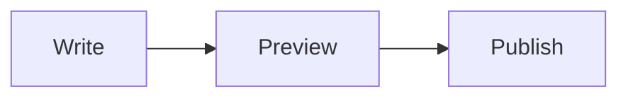

# Forge manual

Everything Forge can do, per topic. New to Forge? Start with the [README](README.md).

Shortcuts are written for Linux and Windows. On macOS, `Ctrl` is the `Cmd` key unless a line says
otherwise; the menus always show the right keys for your system.

**Contents**

1. [Installing and starting](#1-installing-and-starting)
2. [The window](#2-the-window)
3. [Files](#3-files)
4. [Editing](#4-editing)
5. [Find and replace](#5-find-and-replace)
6. [Languages and syntax](#6-languages-and-syntax)
7. [The document toolbar and views](#7-the-document-toolbar-and-views)
8. [Markdown](#8-markdown)
9. [JSON](#9-json)
10. [CSV](#10-csv)
11. [XML](#11-xml)
12. [YAML](#12-yaml)
13. [Compare](#13-compare)
14. [Find in Files](#14-find-in-files)
15. [Developer tools](#15-developer-tools)
16. [Preferences](#16-preferences)
17. [Large files](#17-large-files)
18. [Keyboard shortcuts](#18-keyboard-shortcuts)
19. [Where Forge keeps its files](#19-where-forge-keeps-its-files)
20. [About Forge](#20-about-forge)

---

## 1. Installing and starting

### Downloads

Every release on the [releases page](https://gitlab.com/bytefulminds/forge/-/releases) has a
download per system. They include everything, also the full Markdown preview with Mermaid
diagrams.

| System | Download | Install |
|---|---|---|
| macOS 11 or later, Apple Silicon | `Forge-<version>-macos-arm64.dmg` | Open the disk image and drag Forge to Applications. |
| Linux, x86-64 | `Forge-<version>-linux-x86_64.AppImage` | Make the file executable (`chmod +x`, or *Properties > Permissions* in your file manager) and run it. |
| Windows 10 or 11, x86-64 | `Forge-<version>-setup.exe` | Run the setup. It installs for your account only, unless you choose all users. |

Forge is not signed by Apple or Microsoft yet, so both warn the first time:

- **macOS** blocks the first start. Open *System Settings > Privacy & Security* and click
  *Open Anyway* next to the message about Forge. On macOS 14 and earlier you can also
  right-click Forge in Applications and choose *Open*. This is needed only once.
- **Windows** SmartScreen may say it protected your PC. Click *More info* and then
  *Run anyway*.

The Windows setup adds Forge to the Start menu, offers *Edit with Forge* in the right-click
menu of files (on Windows 11 under *Show more options*), and adds Forge to *Open with* for
common text formats without making it the default app. Uninstall it from *Settings > Apps*.

On Linux the AppImage runs from any folder. To get Forge in your application menu, use a
tool such as [Gear Lever](https://flathub.org/apps/it.mijorus.gearlever) or
AppImageLauncher. Where the system blocks the browser sandbox (Ubuntu 24.04 and later, or
when running as root), the AppImage switches the sandbox of the Markdown preview off; the
preview only shows local files.

### From source

Forge also runs from source with [uv](https://docs.astral.sh/uv/getting-started/installation/),
version `0.11.32` or newer. uv installs Python `3.12.13` and every dependency at the exact
version Forge was tested with.
The same commands work in Terminal (macOS), a Linux shell and PowerShell (Windows).

```sh
git clone https://gitlab.com/bytefulminds/forge.git
cd forge
uv sync                 # or: uv sync --extra web   (full Markdown preview, see section 8)
uv run forge            # start Forge
uv run forge a.md b.csv # start Forge and open files
```

## 2. The window

From top to bottom:

- **Title bar** with the full path of the document. Drag it to move the window,
  double-click it to maximize.
- **Menu bar:** File, Edit, Search, View, Encoding, Language, Settings, Tools and Help.
- **Tabs**, one per document. A dot instead of the close button means unsaved changes.
  - Click `+`, or double-click the empty part of the tab bar, for a new document.
  - Drag tabs to reorder them.
  - Right-click a tab for Close, Close Others, Close All, Copy Full Path,
    Copy File Name and Show in Finder (macOS), Open Containing Folder (Linux) or Show in
    Explorer (Windows).
- **Document toolbar** with tools for the document's language (section 7).
- **Editor**, and next to it or instead of it a preview, if the language has one.
- **Status bar:**
  - Left: line and column (click to go to a line). For CSV, the column at the cursor.
    When the document has a syntax error, the error appears here; click it to jump there.
  - Right: language, line endings and encoding. Click any of them to change it.

Forge has three themes, under Settings > Theme:

- **Forge Dark:** near black with grey surfaces, for people who want a classic dark editor.
- **Forge Blue:** the deep night blue of the Forge brand.
- **Forge Light:** light surfaces with dark text.

*Follow System* switches between Forge Dark and Forge Light with your system setting.

## 3. Files

### Opening and saving

| Action | Shortcut |
|---|---|
| New | `Ctrl+N` |
| Open | `Ctrl+O` |
| Save | `Ctrl+S` |
| Save As | `Ctrl+Alt+S` (macOS `Cmd+Shift+S`) |
| Save All | `Ctrl+Shift+S` (macOS `Cmd+Option+S`) |
| Close | `Ctrl+W` |
| Close All | `Ctrl+Shift+W` |

You can also drop files from your file manager onto the window.

**Save As follows the language.** A new document saved as JSON gets `.json` added if you
type a name without an extension. If you pick "All files", Forge keeps the name exactly as
typed.

The Open and Save dialogs have Forge's look. If you prefer your system's own dialogs
(Finder on macOS, GTK or KDE on Linux, Explorer on Windows), turn on *Use the system file
dialogs* in Preferences.

### Sessions

Forge remembers your open tabs when you quit, including text you never saved, the cursor
position, the language and the view (text, split or preview). Everything comes back the
next time you start Forge. Turn this off with *Remember open tabs and unsaved text* in
Preferences.

### Files that change on disk

Forge watches every open file.

- If another program changes a file and you have no unsaved changes, Forge reloads it.
- If you do have unsaved changes, a bar above the editor offers *Reload from Disk* or
  *Keep My Version*.
- If the file is deleted or moved, Forge keeps your text and offers *Save* (to write it
  again) or *Close Tab*.

### Encodings and line endings

Forge detects the encoding when it opens a file. The Encoding menu (or the encoding in the
status bar) has two kinds of choices:

- **Reload as** reads the file again in another encoding. Use this when characters look
  wrong.
- **Convert to** keeps the text and saves it in the new encoding from now on.

Supported: UTF-8, UTF-8 with BOM, UTF-16 LE and BE, Windows-1252 and ISO-8859-1.

Line endings (Edit > EOL Conversion, or the status bar) can be Windows (CR LF), Unix (LF) or
Macintosh (CR). Forge keeps the line endings a file already has. New documents use LF on
macOS and Linux and CR LF on Windows.

## 4. Editing

- Undo, redo, cut, copy, paste and select all work as everywhere.
- **Right-click** in the editor for the edit commands and the developer tools (section 15).
  The menu only shows what fits: the conversions for the selected text (Base64 Decode only
  when the selection is Base64, Cron Expression only for a cron expression, HTML escaping in
  HTML, XML and Markdown files) and, without a selection, inserting a UUID or the date and
  time.
- **Comments:** toggle with `Ctrl+Q` or `Ctrl+/` (on macOS `Ctrl+Q`, the Control key),
  comment with `Ctrl+K`, uncomment with `Ctrl+Shift+K`. Works on every selected line, in
  every language that has comments.
- **Autocomplete** suggests words from the document and keywords of the language after
  you type 3 characters (adjustable). Ask for suggestions any time with `Ctrl+Space` or
  `Ctrl+Enter`.
- **Brackets:** matching brackets light up next to the cursor. With *Rainbow Brackets*
  (View menu) every nesting level gets its own color; a bracket without a partner is red.
- **Rainbow indentation** (View menu) tints each indentation level, so deep nesting is
  easy to follow.
- **Word wrap**, whitespace and line endings, and line numbers are in the View menu.
- **Zoom** with `Ctrl++`, `Ctrl+-` and `Ctrl+0`.

## 5. Find and replace

`Ctrl+F` opens the find bar above the editor; `Ctrl+H` (macOS `Cmd+Option+F`) opens it with
replace.

- `Enter` finds the next match, `Shift+Enter` the previous one. `F3` and `Shift+F3` work
  too, also when the bar is closed.
- Options: match case, whole word only and regular expression.
- The bar shows "3 of 12" while you search, and every match in the document is highlighted.
- *Replace* replaces the current match; *Replace All* replaces every match as one undo step.
  With regular expressions you can use groups (`\1`) in the replacement.
- `Esc` closes the bar.

Go to a line with `Ctrl+G` (macOS `Cmd+L`) or by clicking the position in the status bar.

To search a whole folder, see [Find in Files](#14-find-in-files).

## 6. Languages and syntax

Forge highlights 23 languages: Python, JSON, YAML, XML, HTML, CSS, JavaScript, Shell,
Markdown, CSV, SQL, C / C++, Java, C#, Properties / INI, Makefile, CMake, Diff, Batch, Perl,
Ruby, Lua and TeX. Everything else opens as normal text.

The language follows the file extension. Change it with the Language menu or by clicking
the language in the status bar; type a few letters to filter the list.

**Live syntax checks.** For Python, JSON, YAML, XML, TOML and CSV, Forge checks the document
while you type. The first error is underlined in red; hover it for the message, or click the
error in the status bar to jump to it. Turn this off with *Underline syntax errors while
typing* in Preferences.

## 7. The document toolbar and views

Every document has a toolbar above the text.

- **Left:** the tools for the document's language, plus *Toggle Comment* when the language
  has comments. Hover a button for its name and shortcut. Language tools live only here
  (their keyboard shortcuts work everywhere in that document); the Tools menu holds the
  general tools. When a language has settings, such as *Auto-close Tags* for XML, the
  last button (the sliders icon) opens them.
- **Right:** word wrap, and for Markdown, CSV and JSON the three views:
  - **Text:** only the editor.
  - **Split:** editor and preview side by side; the preview scrolls along with the editor.
  - **Preview:** only the preview.

`Ctrl+Shift+V` switches the preview on and off. Forge remembers the view per document.
Hide the toolbar with View > Document Toolbar.

## 8. Markdown

### Preview

The preview supports headings, emphasis, links, images (relative to the file), tables,
task lists, strikethrough, footnotes, code blocks and links within the document.

Forge has two previews:

- **Basic** (always available): fast and light, based on Qt's text engine.
- **Full** (with the browser engine): looks like a web page and draws
  [Mermaid](https://mermaid.js.org) diagrams. The downloads include it. From source, install
  it with `uv sync --extra web` (about 200 MB). Forge uses it automatically when it is there. To use the basic preview anyway,
  start Forge with `FORGE_BASIC_MARKDOWN=1`.

Mermaid diagrams go in a code block:

````markdown

````

Without the browser engine, Mermaid blocks show as code with a hint.

For safety, HTML inside a Markdown file is shown as text and never runs. Links open in
your browser. Images from the internet are not loaded; images next to the file are.

### Editing tools

| Button | Does | Shortcut |
|---|---|---|
| Bold, Italic, Inline Code | Wraps the selection, or unwraps it when it is already wrapped | `Ctrl+B`, `Ctrl+I` |
| Link | Turns the selection into `[text](https://)` with the address selected | |
| Heading | Cycles the line through `#`, `##`, `###` and back to text | |
| Quote | Adds or removes `> ` on the selected lines | |
| Bulleted, Numbered, Task List | Turns lines into a list, switches list type, or removes it | |
| Code Block | Puts the selected lines between ```` ``` ```` fences, or removes them | |
| Table | Inserts a table with three columns | |
| Horizontal Rule | Inserts `---` | |

## 9. JSON

| Tool | Does | Shortcut |
|---|---|---|
| Format | Pretty prints with your indentation setting | `Ctrl+Alt+Shift+M` |
| Minify | Puts everything on one line | |
| Validate | Checks the document and jumps to the first error | |
| Tree | Opens the split view with a tree of keys, values and types | |

All JSON tools are one undo step. The preview of a JSON document is the tree. Click a key
or an array item in the tree (or select it and press `Enter`) and Forge selects it in the
code, so you can find a value in a large document by browsing the tree.

## 10. CSV

### Reading

- **Colored columns:** every column has its own color, so wide files stay readable.
- **Delimiter:** Forge detects comma, semicolon, tab or pipe. If it guesses wrong, click the
  delimiter in the status bar or the first toolbar button and pick one; *Detect
  Automatically* goes back to detection. The choice is per document.
- **Header row:** Forge detects whether the first row holds column names. Not every CSV
  file has one, so you can choose with the *Header Row* toolbar button:
  *Detect Automatically*, *First Row Is the Header* or *No Header Row*. The choice is per
  document and is remembered after a restart.
- **Status bar:** shows the column at the cursor, with its name when the file has a header
  row, for example *Column 4: created_at*.
- **Table view:** the preview shows the data as a table. With a header row its names are
  the column titles and the data rows are numbered from 1; without one, the columns are
  numbered and the first line is row 1.
- **Checks:** a row with a different number of columns than the first row, or a quote that
  is never closed, is underlined.

### Tools

| Tool | Does |
|---|---|
| Delimiter | Chooses how the file is read (see above) |
| Header Row | Whether the first row holds the column names (see above) |
| Convert Delimiter | Rewrites the file with another delimiter and adds quotes where cells need them |
| Align Columns | Pads cells with spaces so the columns line up |
| Shrink Columns | Removes the spaces around cells (undoes Align) |
| Sort Ascending, Sort Descending | Sorts rows by the column at the cursor: numbers as numbers (also with a decimal comma such as `3,5`), text without case; the header row stays on top |
| Remove Duplicate Rows | Removes rows that equal an earlier row |
| Epoch to ISO 8601 (UTC) | Turns Unix timestamps into dates in UTC, such as `2025-10-12T08:00:00Z` |
| Epoch to ISO 8601 (Local Time) | The same in your own time zone, with the offset, such as `2025-10-12T10:00:00+02:00` |
| ISO 8601 to Epoch | Turns dates back into Unix timestamps |
| Convert to JSON | Opens the data as JSON in a new tab: with a header row, objects named after the headers; without, one array per row. Numbers become numbers |
| Convert to Markdown Table | Opens the data as a Markdown table in a new tab |

**Timestamps in detail**

- Works on the selection, or without a selection on the whole column at the cursor.
  With a selection it also works in other files, such as logs.
- Seconds, milliseconds, microseconds and nanoseconds are recognized by their number of
  digits (10, 13, 16 or 19).
- Choose UTC (dates end in `Z`) or your local time (dates end in the offset from UTC, such
  as `+02:00`) with the two buttons on the toolbar.
- Dates without a time zone are read as UTC. Turn on *Epoch in Milliseconds* to get
  milliseconds instead of seconds.

**Good to know**

- Tools leave cells they do not change exactly as they were, including quotes and spaces.
- When Forge detects the header row, it counts the first row as a header if it holds no
  numbers or dates and its names do not appear again as values in their own column.
  Sorting, duplicates and conversions keep a header row in place.
- Every tool is one undo step.

## 11. XML

| Tool | Does | Shortcut |
|---|---|---|
| Pretty Print | Indents the document | `Ctrl+Alt+Shift+B` |
| Minify | Removes the whitespace between elements | |
| Check Well-formedness | Checks the document and jumps to the first error | `Ctrl+Alt+Shift+K` |
| Evaluate XPath | Opens a panel to run XPath expressions; click a result to jump to it | |
| Auto-close Tags | Typing `>` after an opening tag adds the closing tag (on by default; options button on the toolbar) | |

## 12. YAML

*Validate YAML* checks the document and jumps to the first error. YAML is also checked while
you type (see section 6).

## 13. Compare

- **Compare with Saved Version:** your unsaved changes against the file on disk.
- **Compare with Tab** (`Ctrl+Alt+C`): the current document against another open tab.

The comparison opens in its own tab with the older version on the left and the newer on
the right:

- green lines are added, orange lines changed, red lines removed;
- changes within a line are marked;
- the arrows jump to the previous and next difference;
- the ⇄ button swaps the sides;
- both sides scroll together.

## 14. Find in Files

Open it with `Ctrl+Shift+F` (Search menu).

1. Type what to find and choose a folder; Forge suggests the folder of the current file.
2. Optionally limit the files with filters, separated by spaces: `*.py *.json` searches only
   those, `!build` skips a folder or pattern.
3. Choose match case, whole word, regular expression and whether to include subfolders.
4. *Find All* lists the matches per file. Click a match to open the file at that line.

*Replace in Files* replaces in every matching file after asking for confirmation. Files are
changed on disk, so this cannot be undone with Undo. Files you have open with unsaved
changes are skipped (your tab wins); open files without changes reload automatically.

Forge skips binary files and folders such as `.git` and `node_modules`. Large searches run in
the background and can be cancelled.

## 15. Developer tools

The Tools menu holds the general tools: Compare (section 13) and a set of everyday developer
tools, grouped in submenus. The ones that work on text are also in the editor's right-click
menu, which only offers what fits the document's language and the selected text.

### Hash

- **Hash Selection:** MD5, SHA-1, SHA-256 and SHA-512 of the selected text (or of the whole
  document without a selection), each with a copy button. Text is hashed as UTF-8.
- **Hash Files:** choose one or more files (up to 20) and get the same four hashes for each.

### Encode / Decode

Works on the selection and replaces it (one undo step), so `Ctrl+Z` brings back the original.

| Tool | Example |
|---|---|
| Base64 Encode, Decode | `hello` and `aGVsbG8=`; decoding also accepts the URL-safe alphabet and missing padding |
| URL Encode, Decode | `a b&c` and `a%20b%26c` |
| HTML Escape, Unescape | `<b>` and `&lt;b&gt;` |
| JSON String Escape, Unescape | a line break and `\n`, a quote and `\"` |
| Decode JWT | Opens the header and payload of a JSON Web Token as JSON in a new tab, with `iat`, `nbf` and `exp` as dates. The signature is not checked |

When the selection cannot be converted (for example invalid Base64), the text stays as it
is and the status bar says why.

### Text

- **Letter case:** UPPERCASE, lowercase, Title Case, camelCase, PascalCase, snake_case and
  kebab-case. The last four split words at spaces, underscores, hyphens and capitals, so
  `parseHttpResponse` becomes `parse_http_response`.
- **Lines:** Sort Lines Ascending or Descending (natural order without case: `file2` before
  `file10`), Remove Duplicate Lines, Reverse Lines and Trim Trailing Whitespace. They work on
  the selected lines, or on the whole document without a selection.

### Generate

- **Insert UUID:** a random UUID (version 4) at the cursor.
- **Insert UUIDs:** choose how many (up to 10,000), version 4 (random) or version 7 (time
  ordered, sorts by creation time, good for database keys), uppercase, with or without
  hyphens, in braces as a Windows GUID, one per line or comma separated.

### Date and Time

- **Insert Date and Time:** the current local time in ISO 8601, for example
  `2026-10-13T14:05:09+02:00`; **(UTC)** inserts `2026-10-13T12:05:09Z`.
- **Insert Date** (`2026-10-13`) and **Insert Unix Timestamp** (seconds).
- **Epoch to ISO 8601 (UTC)**, **Epoch to ISO 8601 (Local Time)** and **ISO 8601 to
  Epoch:** convert every timestamp in the selection, as the CSV tools do (section 10). Local
  time includes the offset from UTC, for example `2023-11-15T00:13:20+02:00`. All three are
  in the right-click menu when the selection holds a timestamp or a date.
- **Date and Time Converter:** type or paste a Unix timestamp (seconds, milliseconds,
  microseconds or nanoseconds), an ISO 8601 date, an RFC 2822 date (as in e-mail and HTTP
  headers) or `now`, and see it as Unix seconds and milliseconds, ISO 8601 in UTC and local
  time, RFC 2822, and how long ago or how far away it is. Each value has a copy button. The
  selection, when there is one, is filled in.

### Cron

**Cron Expression** opens one window to write or check a schedule. Everything updates while
you type:

- At the top, the expression and what it means in words, for example
  *Every 15 minutes, between 09:00 and 17:59, Monday to Friday*.
- Below it, one card per field with its value and meaning. A card with a mistake turns red
  and says what is wrong.
- **Next runs:** the next ten times, in local time or UTC, with how far away each one is.
  *24-hour clock* switches between `17:00` and `5:00 PM`. Forge remembers both choices.
- **Cheat sheet:** the symbols and shortcuts. Click a row to load its example.
- **Copy** copies the expression. **Insert** puts it at the cursor; when you opened the window
  on a selected expression, **Replace Selection** puts your edited version back.

Select an expression, or a whole crontab line such as `0 2 * * * /opt/backup.sh`, before
you open the window to have it filled in. The command stays as it is.

- Five fields: minute, hour, day of the month, month, day of the week. Six fields put
  seconds first, as Quartz and Spring do.
- Values, ranges (`1-5`), steps (`*/15`, `10-50/10`), lists (`1,15`), names (`JAN`, `MON`),
  Sunday as `0` or `7`, `?` as "any" (Quartz), and the shortcuts `@yearly` (`@annually`),
  `@monthly`, `@weekly`, `@daily` (`@midnight`), `@hourly` and `@reboot`.
- As in standard cron, when both the day of the month and the day of the week are set, the
  job runs when either one matches.

Example: `30 7 * * MON-FRI` is *At 07:30, Monday to Friday*.

## 16. Preferences

Settings > Preferences (`Ctrl+,`). Changes show immediately; *Cancel* undoes them.

| Section | Setting |
|---|---|
| Editor | Font and font size (JetBrains Mono is included), tab width, indent with spaces or tabs |
| | Word wrap, whitespace and line endings, line numbers, highlight the current line |
| | Rainbow brackets, rainbow indentation, live syntax checks |
| | Autocomplete and after how many characters |
| Appearance | Theme (Forge Dark, Forge Blue, Forge Light or follow the system) and interface language (English or Nederlands) |
| Session | Remember open tabs and unsaved text; use the system file dialogs |

The interface language changes after a restart.

## 17. Large files

Forge stays responsive with big files:

- Files load in the background with a progress indicator.
- From 20 MB, syntax highlighting, word wrap and folding are off for that file.
- Bracket colors and live checks stop above about 2 MB.
- Previews are not rendered for documents above 20 million characters.

## 18. Keyboard shortcuts

| Action | Linux and Windows | macOS |
|---|---|---|
| New, Open, Save | `Ctrl+N`, `Ctrl+O`, `Ctrl+S` | `Cmd+N`, `Cmd+O`, `Cmd+S` |
| Save As | `Ctrl+Alt+S` | `Cmd+Shift+S` |
| Save All | `Ctrl+Shift+S` | `Cmd+Option+S` |
| Close, Close All | `Ctrl+W`, `Ctrl+Shift+W` | `Cmd+W`, `Cmd+Shift+W` |
| Quit | `Alt+F4` | `Cmd+Q` |
| Find | `Ctrl+F` | `Cmd+F` |
| Find next, previous | `F3`, `Shift+F3` | `Cmd+G`, `Cmd+Shift+G` |
| Replace | `Ctrl+H` | `Cmd+Option+F` |
| Go to line | `Ctrl+G` | `Cmd+L` |
| Find in Files | `Ctrl+Shift+F` | `Cmd+Shift+F` |
| Toggle comment | `Ctrl+Q`, `Ctrl+/` | `Ctrl+Q`, `Cmd+/` |
| Comment, uncomment | `Ctrl+K`, `Ctrl+Shift+K` | `Cmd+K`, `Cmd+Shift+K` |
| Complete word | `Ctrl+Space`, `Ctrl+Enter` | `Cmd+Enter` |
| Toggle preview | `Ctrl+Shift+V` | `Cmd+Shift+V` |
| Zoom in, out, reset | `Ctrl++`, `Ctrl+-`, `Ctrl+0` | `Cmd++`, `Cmd+-`, `Cmd+0` |
| Format JSON | `Ctrl+Alt+Shift+M` | `Cmd+Option+Shift+M` |
| XML pretty print, check | `Ctrl+Alt+Shift+B`, `Ctrl+Alt+Shift+K` | `Cmd+Option+Shift+B`, `Cmd+Option+Shift+K` |
| Markdown bold, italic | `Ctrl+B`, `Ctrl+I` | `Cmd+B`, `Cmd+I` |
| Compare with tab | `Ctrl+Alt+C` | `Cmd+Option+C` |
| Preferences | `Ctrl+,` | `Cmd+,` |

## 19. Where Forge keeps its files

| | macOS | Linux | Windows |
|---|---|---|---|
| Settings | `~/Library/Application Support/Forge/settings.toml` | `~/.config/forge/settings.toml` | `%LOCALAPPDATA%\Forge\settings.toml` |
| Session and unsaved text | `~/Library/Caches/Forge/` | `~/.cache/forge/` | `%LOCALAPPDATA%\Forge\Cache\` |
| Logs | `~/Library/Logs/Forge/` | `~/.local/state/forge/log/` | `%LOCALAPPDATA%\Forge\Logs\` |

Set `FORGE_HOME=/some/folder` to keep everything in one folder instead.

If something goes wrong, the log usually says why; please attach it when you report a
problem.

## 20. About Forge

Help > About Forge shows the version, links to this manual, the source code and the issue
tracker, and the software Forge is built with. **Copy System Info** puts the Forge, Python,
Qt and operating system versions and Forge's folders on the clipboard; paste it into a bug
report.
