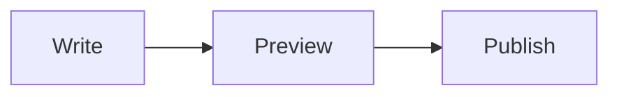

# Forge manual

Everything Forge can do, per topic. New to Forge? Start with the [README](README.md).

Shortcuts are written for Linux. On macOS, `Ctrl` is the `Cmd` key unless a line says
otherwise; the menus always show the right keys for your system.

**Contents**

1. [Installing and starting](#1-installing-and-starting)
2. [The window](#2-the-window)
3. [Files](#3-files)
4. [Editing](#4-editing)
5. [Find and replace](#5-find-and-replace)
6. [Languages and syntax](#6-languages-and-syntax)
7. [The document toolbar and views](#7-the-document-toolbar-and-views)
8. [Markdown](#8-markdown)
9. [JSON](#9-json)
10. [CSV](#10-csv)
11. [XML](#11-xml)
12. [YAML](#12-yaml)
13. [Compare](#13-compare)
14. [Find in Files](#14-find-in-files)
15. [Preferences](#15-preferences)
16. [Large files](#16-large-files)
17. [Keyboard shortcuts](#17-keyboard-shortcuts)
18. [Where Forge keeps its files](#18-where-forge-keeps-its-files)

---

## 1. Installing and starting

Forge runs from source with [uv](https://docs.astral.sh/uv/getting-started/installation/),
version `0.11.32` or newer. uv installs Python `3.12.13` and every dependency at the exact
version Forge was tested with.

```sh
git clone https://gitlab.com/bytefulminds/forge.git
cd forge
uv sync                 # or: uv sync --extra web   (full Markdown preview, see section 8)
uv run forge            # start Forge
uv run forge a.md b.csv # start Forge and open files
```

## 2. The window

From top to bottom:

- **Title bar** with the full path of the document. Drag it to move the window,
  double-click it to maximize.
- **Menu bar:** File, Edit, Search, View, Encoding, Language, Settings, Tools and Help.
- **Tabs**, one per document. A dot instead of the close button means unsaved changes.
  - Click `+`, or double-click the empty part of the tab bar, for a new document.
  - Drag tabs to reorder them.
  - Right-click a tab for Close, Close Others, Close All, Copy Full Path,
    Copy File Name and Show in Finder (macOS) or Open Containing Folder (Linux).
- **Document toolbar** with tools for the document's language (section 7).
- **Editor**, and next to it or instead of it a preview, if the language has one.
- **Status bar:**
  - Left: line and column (click to go to a line). For CSV, the column at the cursor.
    When the document has a syntax error, the error appears here; click it to jump there.
  - Right: language, line endings and encoding. Click any of them to change it.

Forge has a dark and a light theme, or follows your system setting (Settings > Theme).

## 3. Files

### Opening and saving

| Action | Shortcut |
|---|---|
| New | `Ctrl+N` |
| Open | `Ctrl+O` |
| Save | `Ctrl+S` |
| Save As | `Ctrl+Alt+S` (macOS `Cmd+Shift+S`) |
| Save All | `Ctrl+Shift+S` (macOS `Cmd+Option+S`) |
| Close | `Ctrl+W` |
| Close All | `Ctrl+Shift+W` |

You can also drop files from your file manager onto the window.

**Save As follows the language.** A new document saved as JSON gets `.json` added if you
type a name without an extension. If you pick "All files", Forge keeps the name exactly as
typed.

The Open and Save dialogs have Forge's look. If you prefer your system's own dialogs
(Finder on macOS, GTK or KDE on Linux), turn on *Use the system file dialogs* in Preferences.

### Sessions

Forge remembers your open tabs when you quit, including text you never saved, the cursor
position, the language and the view (text, split or preview). Everything comes back the
next time you start Forge. Turn this off with *Remember open tabs and unsaved text* in
Preferences.

### Files that change on disk

Forge watches every open file.

- If another program changes a file and you have no unsaved changes, Forge reloads it.
- If you do have unsaved changes, a bar above the editor offers *Reload from Disk* or
  *Keep My Version*.
- If the file is deleted or moved, Forge keeps your text and offers *Save* (to write it
  again) or *Close Tab*.

### Encodings and line endings

Forge detects the encoding when it opens a file. The Encoding menu (or the encoding in the
status bar) has two kinds of choices:

- **Reload as** reads the file again in another encoding. Use this when characters look
  wrong.
- **Convert to** keeps the text and saves it in the new encoding from now on.

Supported: UTF-8, UTF-8 with BOM, UTF-16 LE and BE, Windows-1252 and ISO-8859-1.

Line endings (Edit > EOL Conversion, or the status bar) can be Windows (CR LF), Unix (LF) or
Macintosh (CR). Forge keeps the line endings a file already has.

## 4. Editing

- Undo, redo, cut, copy, paste and select all work as everywhere.
- **Comments:** toggle with `Ctrl+Q` or `Ctrl+/` (on macOS `Ctrl+Q`, the Control key),
  comment with `Ctrl+K`, uncomment with `Ctrl+Shift+K`. Works on every selected line, in
  every language that has comments.
- **Autocomplete** suggests words from the document and keywords of the language after
  you type 3 characters (adjustable). Ask for suggestions any time with `Ctrl+Space` or
  `Ctrl+Enter`.
- **Brackets:** matching brackets light up next to the cursor. With *Rainbow Brackets*
  (View menu) every nesting level gets its own color; a bracket without a partner is red.
- **Rainbow indentation** (View menu) tints each indentation level, so deep nesting is
  easy to follow.
- **Word wrap**, whitespace and line endings, and line numbers are in the View menu.
- **Zoom** with `Ctrl++`, `Ctrl+-` and `Ctrl+0`.

## 5. Find and replace

`Ctrl+F` opens the find bar above the editor; `Ctrl+H` (macOS `Cmd+Option+F`) opens it with
replace.

- `Enter` finds the next match, `Shift+Enter` the previous one. `F3` and `Shift+F3` work
  too, also when the bar is closed.
- Options: match case, whole word only and regular expression.
- The bar shows "3 of 12" while you search, and every match in the document is highlighted.
- *Replace* replaces the current match; *Replace All* replaces every match as one undo step.
  With regular expressions you can use groups (`\1`) in the replacement.
- `Esc` closes the bar.

Go to a line with `Ctrl+G` (macOS `Cmd+L`) or by clicking the position in the status bar.

To search a whole folder, see [Find in Files](#14-find-in-files).

## 6. Languages and syntax

Forge highlights 23 languages: Python, JSON, YAML, XML, HTML, CSS, JavaScript, Shell,
Markdown, CSV, SQL, C / C++, Java, C#, Properties / INI, Makefile, CMake, Diff, Batch, Perl,
Ruby, Lua and TeX. Everything else opens as normal text.

The language follows the file extension. Change it with the Language menu or by clicking
the language in the status bar; type a few letters to filter the list.

**Live syntax checks.** For Python, JSON, YAML, XML, TOML and CSV, Forge checks the document
while you type. The first error is underlined in red; hover it for the message, or click the
error in the status bar to jump to it. Turn this off with *Underline syntax errors while
typing* in Preferences.

## 7. The document toolbar and views

Every document has a toolbar above the text.

- **Left:** the tools for the document's language, plus *Toggle Comment* when the language
  has comments. Hover a button for its name and shortcut. The same tools are in the Tools
  menu.
- **Right:** word wrap, and for Markdown, CSV and JSON the three views:
  - **Text:** only the editor.
  - **Split:** editor and preview side by side; the preview scrolls along with the editor.
  - **Preview:** only the preview.

`Ctrl+Shift+V` switches the preview on and off. Forge remembers the view per document.
Hide the toolbar with View > Document Toolbar.

## 8. Markdown

### Preview

The preview supports headings, emphasis, links, images (relative to the file), tables,
task lists, strikethrough, footnotes, code blocks and links within the document.

Forge has two previews:

- **Basic** (always available): fast and light, based on Qt's text engine.
- **Full** (with the optional browser engine): looks like a web page and draws
  [Mermaid](https://mermaid.js.org) diagrams. Install it with `uv sync --extra web` (about
  200 MB). Forge uses it automatically when it is there. To use the basic preview anyway,
  start Forge with `FORGE_BASIC_MARKDOWN=1`.

Mermaid diagrams go in a code block:

````markdown

````

Without the browser engine, Mermaid blocks show as code with a hint.

For safety, HTML inside a Markdown file is shown as text and never runs. Links open in
your browser. Images from the internet are not loaded; images next to the file are.

### Editing tools

| Button | Does | Shortcut |
|---|---|---|
| Bold, Italic, Inline Code | Wraps the selection, or unwraps it when it is already wrapped | `Ctrl+B`, `Ctrl+I` |
| Link | Turns the selection into `[text](https://)` with the address selected | |
| Heading | Cycles the line through `#`, `##`, `###` and back to text | |
| Quote | Adds or removes `> ` on the selected lines | |
| Bulleted, Numbered, Task List | Turns lines into a list, switches list type, or removes it | |
| Code Block | Puts the selected lines between ```` ``` ```` fences, or removes them | |
| Table | Inserts a table with three columns | |
| Horizontal Rule | Inserts `---` | |

## 9. JSON

| Tool | Does | Shortcut |
|---|---|---|
| Format | Pretty prints with your indentation setting | `Ctrl+Alt+Shift+M` |
| Minify | Puts everything on one line | |
| Validate | Checks the document and jumps to the first error | |
| Tree | Opens the split view with a tree of keys, values and types | |

All JSON tools are one undo step. The preview of a JSON document is the tree.

## 10. CSV

### Reading

- **Colored columns:** every column has its own color, so wide files stay readable.
- **Delimiter:** Forge detects comma, semicolon, tab or pipe. If it guesses wrong, click the
  delimiter in the status bar or the first toolbar button and pick one; *Detect
  Automatically* goes back to detection. The choice is per document.
- **Status bar:** shows the column at the cursor with its name from the first row, for
  example *Column 4: created_at*.
- **Table view:** the preview shows the data as a table with the first row as headers and
  the file's line numbers on the left.
- **Checks:** a row with a different number of columns than the first row, or a quote that
  is never closed, is underlined.

### Tools

| Tool | Does |
|---|---|
| Delimiter | Chooses how the file is read (see above) |
| Convert Delimiter | Rewrites the file with another delimiter and adds quotes where cells need them |
| Align Columns | Pads cells with spaces so the columns line up |
| Shrink Columns | Removes the spaces around cells (undoes Align) |
| Sort Ascending, Sort Descending | Sorts rows by the column at the cursor: numbers as numbers (also with a decimal comma such as `3,5`), text without case; the header row stays on top |
| Remove Duplicate Rows | Removes rows that equal an earlier row |
| Epoch to ISO 8601 | Turns Unix timestamps into dates such as `2025-10-12T08:00:00Z` |
| ISO 8601 to Epoch | Turns dates back into Unix timestamps |
| Convert to JSON | Opens the data as JSON in a new tab: objects named after the headers, numbers as numbers |
| Convert to Markdown Table | Opens the data as a Markdown table in a new tab |

**Timestamps in detail**

- Works on the selection, or without a selection on the whole column at the cursor.
  With a selection it also works in other files, such as logs.
- Seconds, milliseconds, microseconds and nanoseconds are recognized by their number of
  digits (10, 13, 16 or 19).
- Dates are written in UTC with a `Z`. Turn on *Tools > CSV > Use Local Time* for your own
  time zone.
- Dates without a time zone are read as UTC. Turn on *Epoch in Milliseconds* to get
  milliseconds instead of seconds.

**Good to know**

- Tools leave cells they do not change exactly as they were, including quotes and spaces.
- Forge decides whether the first row is a header: it is when it holds no numbers or dates
  and its names do not appear again as values in their own column. Sorting, duplicates and
  conversions keep a header row in place.
- Every tool is one undo step.

## 11. XML

| Tool | Does | Shortcut |
|---|---|---|
| Pretty Print | Indents the document | `Ctrl+Alt+Shift+B` |
| Minify | Removes the whitespace between elements | |
| Check Well-formedness | Checks the document and jumps to the first error | `Ctrl+Alt+Shift+K` |
| Evaluate XPath | Opens a panel to run XPath expressions; click a result to jump to it | |
| Auto-close Tags | Typing `>` after an opening tag adds the closing tag (on by default) | |

## 12. YAML

*Validate YAML* checks the document and jumps to the first error. YAML is also checked while
you type (see section 6).

## 13. Compare

- **Compare with Saved Version:** your unsaved changes against the file on disk.
- **Compare with Tab** (`Ctrl+Alt+C`): the current document against another open tab.

The comparison opens in its own tab with the older version on the left and the newer on
the right:

- green lines are added, orange lines changed, red lines removed;
- changes within a line are marked;
- the arrows jump to the previous and next difference;
- the ⇄ button swaps the sides;
- both sides scroll together.

## 14. Find in Files

Open it with `Ctrl+Shift+F` (Search menu).

1. Type what to find and choose a folder; Forge suggests the folder of the current file.
2. Optionally limit the files with filters, separated by spaces: `*.py *.json` searches only
   those, `!build` skips a folder or pattern.
3. Choose match case, whole word, regular expression and whether to include subfolders.
4. *Find All* lists the matches per file. Click a match to open the file at that line.

*Replace in Files* replaces in every matching file after asking for confirmation. Files are
changed on disk, so this cannot be undone with Undo. Files you have open with unsaved
changes are skipped (your tab wins); open files without changes reload automatically.

Forge skips binary files and folders such as `.git` and `node_modules`. Large searches run in
the background and can be cancelled.

## 15. Preferences

Settings > Preferences (`Ctrl+,`). Changes show immediately; *Cancel* undoes them.

| Section | Setting |
|---|---|
| Editor | Font and font size (JetBrains Mono is included), tab width, indent with spaces or tabs |
| | Word wrap, whitespace and line endings, line numbers, highlight the current line |
| | Rainbow brackets, rainbow indentation, live syntax checks |
| | Autocomplete and after how many characters |
| Appearance | Theme (dark, light or follow the system) and interface language (English or Nederlands) |
| Session | Remember open tabs and unsaved text; use the system file dialogs |

The interface language changes after a restart.

## 16. Large files

Forge stays responsive with big files:

- Files load in the background with a progress indicator.
- From 20 MB, syntax highlighting, word wrap and folding are off for that file.
- Bracket colors and live checks stop above about 2 MB.
- Previews are not rendered for documents above 20 million characters.

## 17. Keyboard shortcuts

| Action | Linux | macOS |
|---|---|---|
| New, Open, Save | `Ctrl+N`, `Ctrl+O`, `Ctrl+S` | `Cmd+N`, `Cmd+O`, `Cmd+S` |
| Save As | `Ctrl+Alt+S` | `Cmd+Shift+S` |
| Save All | `Ctrl+Shift+S` | `Cmd+Option+S` |
| Close, Close All | `Ctrl+W`, `Ctrl+Shift+W` | `Cmd+W`, `Cmd+Shift+W` |
| Quit | `Alt+F4` | `Cmd+Q` |
| Find | `Ctrl+F` | `Cmd+F` |
| Find next, previous | `F3`, `Shift+F3` | `Cmd+G`, `Cmd+Shift+G` |
| Replace | `Ctrl+H` | `Cmd+Option+F` |
| Go to line | `Ctrl+G` | `Cmd+L` |
| Find in Files | `Ctrl+Shift+F` | `Cmd+Shift+F` |
| Toggle comment | `Ctrl+Q`, `Ctrl+/` | `Ctrl+Q`, `Cmd+/` |
| Comment, uncomment | `Ctrl+K`, `Ctrl+Shift+K` | `Cmd+K`, `Cmd+Shift+K` |
| Complete word | `Ctrl+Space`, `Ctrl+Enter` | `Cmd+Enter` |
| Toggle preview | `Ctrl+Shift+V` | `Cmd+Shift+V` |
| Zoom in, out, reset | `Ctrl++`, `Ctrl+-`, `Ctrl+0` | `Cmd++`, `Cmd+-`, `Cmd+0` |
| Format JSON | `Ctrl+Alt+Shift+M` | `Cmd+Option+Shift+M` |
| XML pretty print, check | `Ctrl+Alt+Shift+B`, `Ctrl+Alt+Shift+K` | `Cmd+Option+Shift+B`, `Cmd+Option+Shift+K` |
| Markdown bold, italic | `Ctrl+B`, `Ctrl+I` | `Cmd+B`, `Cmd+I` |
| Compare with tab | `Ctrl+Alt+C` | `Cmd+Option+C` |
| Preferences | `Ctrl+,` | `Cmd+,` |

## 18. Where Forge keeps its files

| | Linux | macOS |
|---|---|---|
| Settings | `~/.config/forge/settings.toml` | `~/Library/Application Support/Forge/settings.toml` |
| Session and unsaved text | `~/.cache/forge/` | `~/Library/Caches/Forge/` |
| Logs | `~/.local/state/forge/log/` | `~/Library/Logs/Forge/` |

Set `FORGE_HOME=/some/folder` to keep everything in one folder instead.

If something goes wrong, the log usually says why; please attach it when you report a
problem.
