<div align="center">
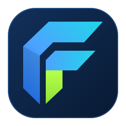


# Forge

**Fast, lightweight text editor for macOS, Linux and Windows, built around the tools a
  developer reaches for every day. Open a file, get to work. Tools for JSON, CSV, Markdown,
  XML and YAML are built in, not bolted on.**

**Version 0.1.0** · [download](https://gitlab.com/bytefulminds/Forge/-/releases) for macOS, Linux and Windows

[](https://gitlab.com/bytefulminds/Forge/-/pipelines)


</div>

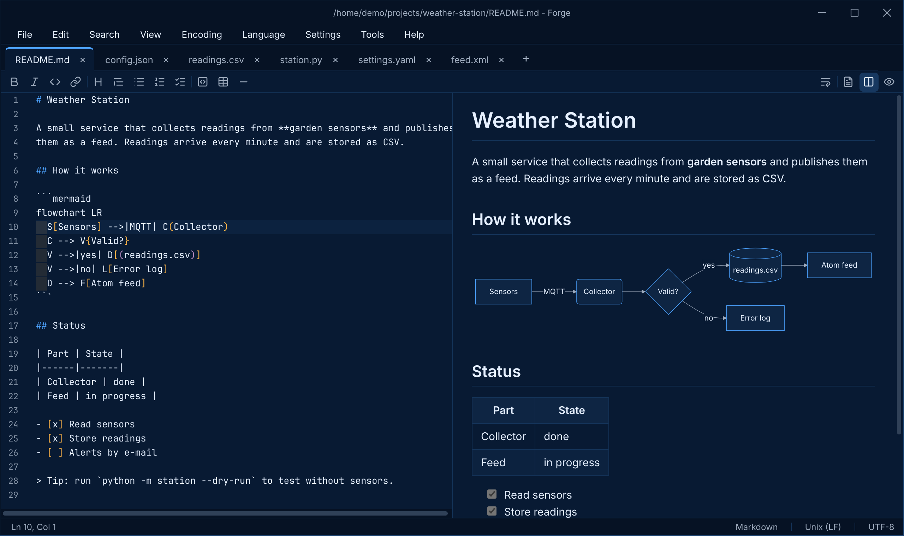

> **Status:** first release. Feedback and bug reports are welcome in the
> [issue tracker](https://gitlab.com/bytefulminds/forge/-/issues).

## Why Forge

- **Starts fast, stays fast.** Large files load in the background. Above 20 MB, Forge turns off
  the heavy features, so even huge logs scroll smoothly.
- **Knows your files.** Every document gets a toolbar with the tools for its language:
  formatting, validation, previews and conversions, one click away.
- **A developer's toolbox built in.** Hashes, Base64 and URL encoding, letter case,
  UUIDs, timestamps and cron expressions, from the Tools menu or a right click.
- **Looks the same everywhere.** Forge draws its own window, menus and dialogs, in three
  themes (Forge Dark, Forge Blue and Forge Light), on macOS, Linux and Windows.
- **Never loses work.** Unsaved text and open tabs come back after a restart, and Forge
  notices when a file changes on disk.

## Highlights

### Markdown with a live preview

Write on the left, read on the right. Tables, task lists, footnotes and
[Mermaid](https://mermaid.js.org) diagrams render as you type. The toolbar has buttons for
bold, headings, lists, links, code blocks and tables.

### JSON: format, validate, explore

Format or minify with one click. Errors are underlined at the exact spot as you type,
and the tree view shows the structure of the document: click a key in the tree and Forge
selects it in the code.

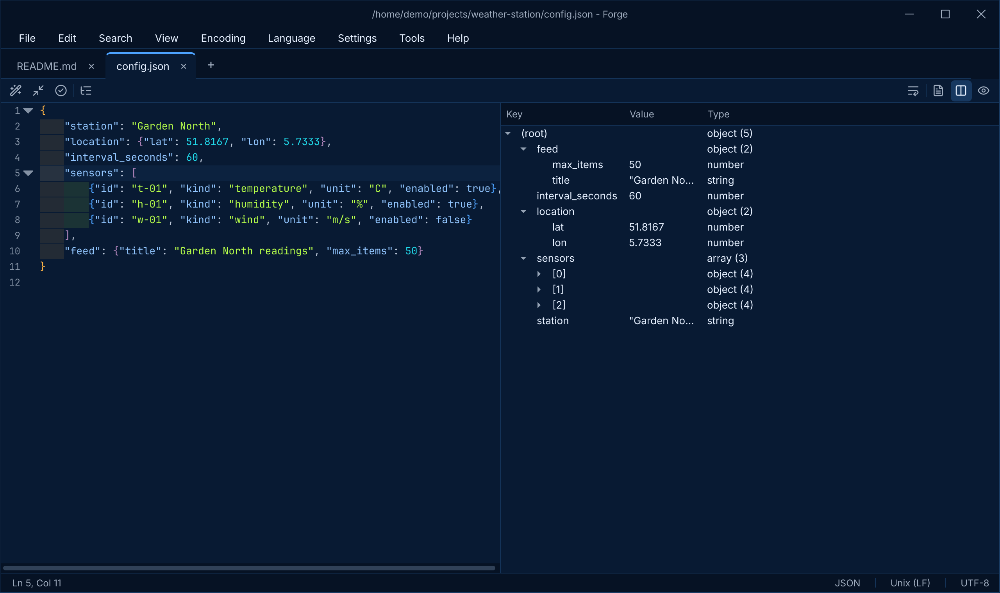

### CSV that understands your data

Every column has its own color, and a table view sits next to the text. Forge detects
the delimiter (comma, semicolon, tab or pipe) and whether the first row is a header, and
you can override both per file. The status bar shows the column name at the cursor.
Sort by a column, align columns, remove duplicate rows, convert Unix timestamps to
ISO 8601 and back, or export to JSON or a Markdown table.

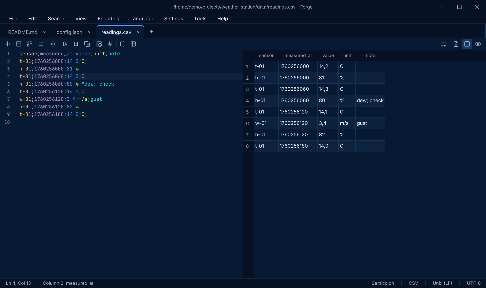

### Developer tools, one right click away

Select text and right-click: encode or decode Base64, URLs, HTML and JSON strings, decode
a JWT, change the letter case (camelCase, snake_case, kebab-case and more), sort or
deduplicate lines, or hash it with MD5, SHA-1, SHA-256 and SHA-512. The Tools menu also
hashes whole files, inserts UUIDs (version 4 or time ordered version 7, one or many) and
the current date and time, and converts between timestamps and dates, in UTC or your
local time. The cron window explains an expression in plain words, per field, with its next
run times and a cheat sheet, and puts the result back in your file.

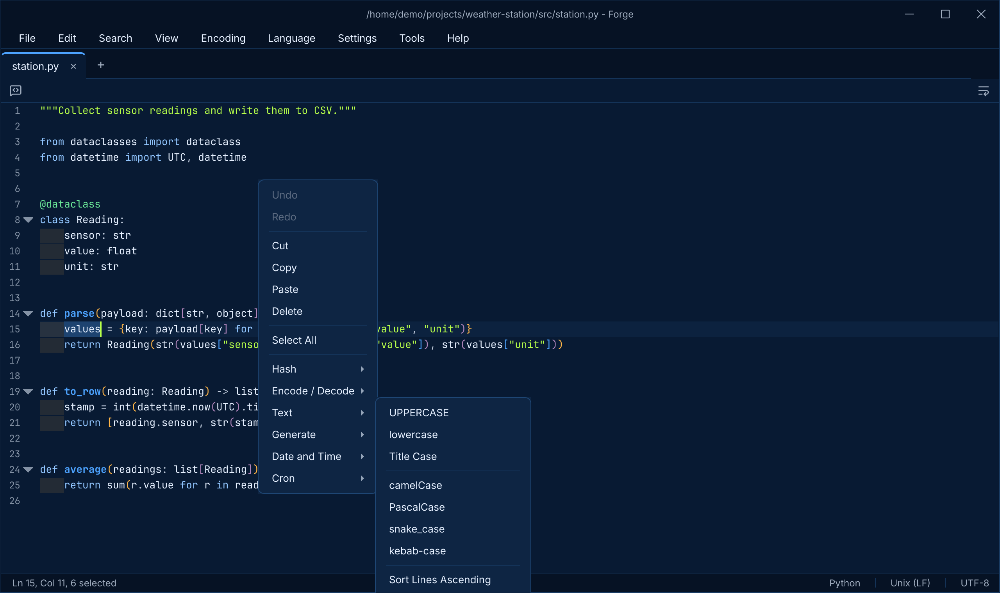

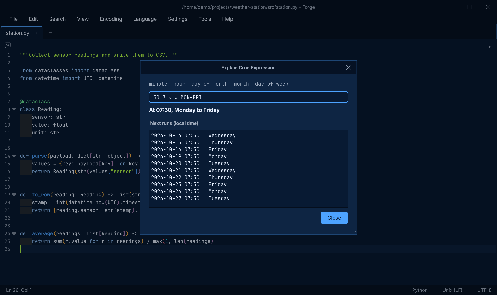

### Compare two versions

Compare a document with its saved version or with another tab. Added lines are green,
changed lines orange, removed lines red, and changes within a line are marked too.

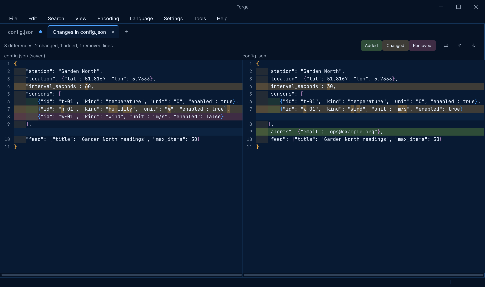

### Find in Files

Search and replace across a whole folder, with regular expressions, case and whole word
options and file filters such as `*.py *.json !build`. Click a result to jump to it.

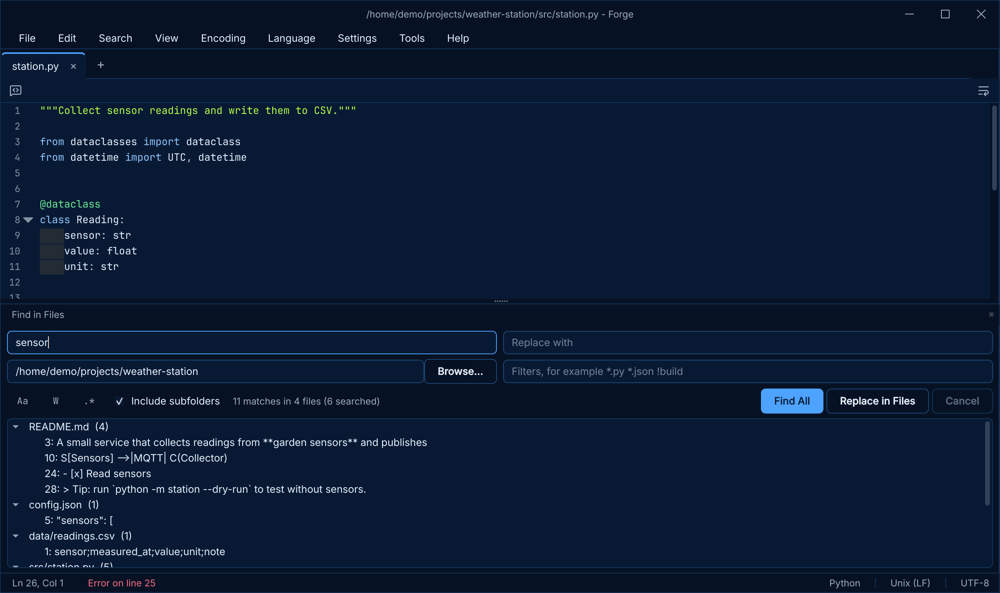

### Made for code

Syntax highlighting for 23 languages, rainbow brackets and indentation, live syntax
checks for Python, JSON, YAML, XML, TOML and CSV, autocomplete from the words in your
file, and the classic editor shortcuts your fingers already know.

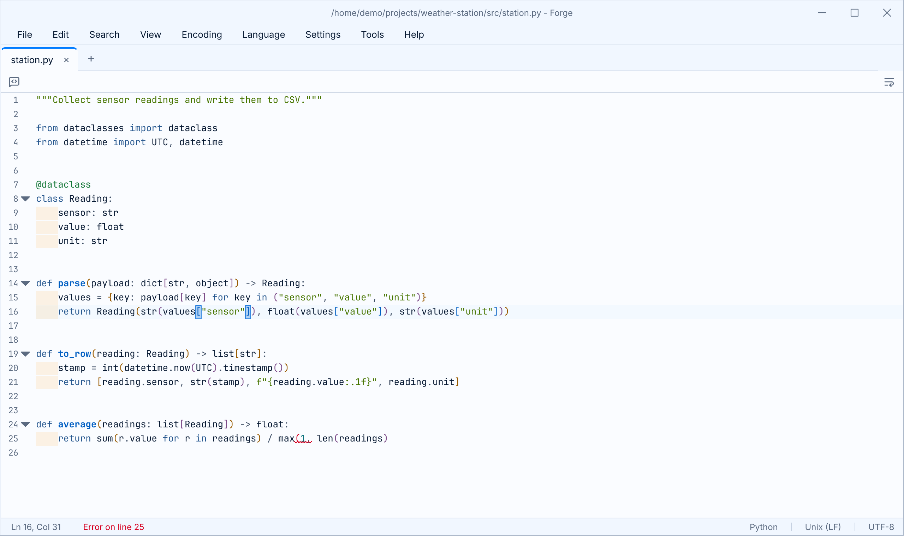

### Three themes

Forge Dark is near black with grey surfaces, Forge Blue has the deep night blue of the Forge
brand, and Forge Light is for bright rooms. *Follow System* switches between dark and light
with your operating system.

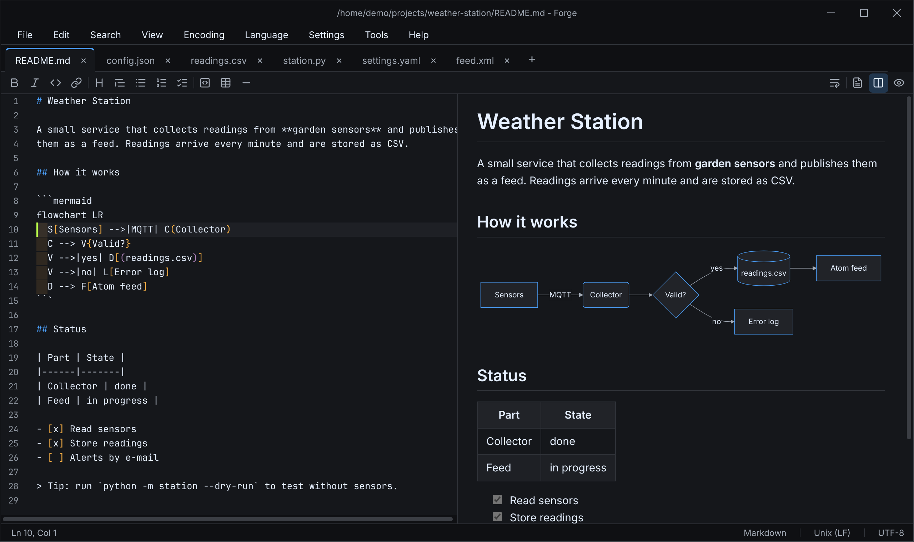

### Yours in two languages

The whole interface is available in English and Dutch, and follows your system language
by default. The About window has a one-click "Copy System Info" for bug reports.

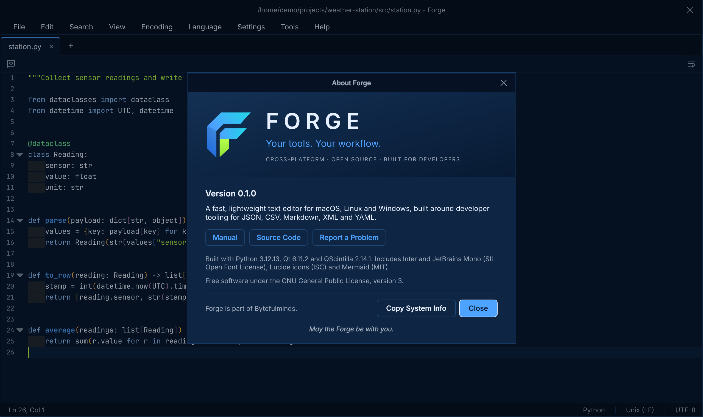

## Download

Get the latest version from the [releases page](https://gitlab.com/bytefulminds/forge/-/releases).
The downloads include everything, also the full Markdown preview with Mermaid diagrams.

| System | Download |
|---|---|
| macOS 11 or later, Apple Silicon | `Forge-<version>-macos-arm64.dmg`: drag Forge to Applications |
| Linux, x86-64 | `Forge-<version>-linux-x86_64.AppImage`: make it executable and run it |
| Windows 10 or 11, x86-64 | `Forge-<version>-setup.exe`: run the setup |

After that, Forge keeps itself up to date: when there is a new version it offers to
install it and restart, on every system. You can turn this off in Preferences.

Forge is not signed by Apple or Microsoft yet. On macOS, allow the first start in
*System Settings > Privacy & Security* with *Open Anyway*; on Windows, choose *More info*
and *Run anyway* if SmartScreen warns. The [manual](MANUAL.md#1-installing-and-starting)
has the details.

## Run from source

You need [uv](https://docs.astral.sh/uv/getting-started/installation/) (version `0.11.32` or
newer). uv installs the right Python version by itself.

```sh
git clone https://gitlab.com/bytefulminds/forge.git
cd forge
uv sync
uv run forge
```

The same commands work in Terminal (macOS), a Linux shell and PowerShell (Windows).
Open files directly with `uv run forge notes.md data.csv`.

For the full Markdown preview with Mermaid diagrams, install the optional browser engine
(about 200 MB) with `uv sync --extra web` instead.

### First steps

| To | macOS | Linux and Windows |
|---|---|---|
| Open a file | `Cmd+O` | `Ctrl+O` |
| Save as | `Cmd+Shift+S` | `Ctrl+Alt+S` |
| Find, replace | `Cmd+F`, `Cmd+Option+F` | `Ctrl+F`, `Ctrl+H` |
| Find in files | `Cmd+Shift+F` | `Ctrl+Shift+F` |
| Go to line | `Cmd+L` | `Ctrl+G` |
| Toggle comment | `Ctrl+Q` | `Ctrl+Q` |
| Show the preview | `Cmd+Shift+V` | `Ctrl+Shift+V` |
| Preferences | `Cmd+,` | `Ctrl+,` |

**Read the [manual](MANUAL.md)** for every feature, tool and shortcut.

## Development

```sh
uv run ruff check .         # lint
uv run ruff format .        # format
uv run mypy                 # type check
uv run pytest               # tests (headless, no display needed)
FORGE_TEST_WEBENGINE=1 uv run pytest tests/ui/test_web_preview.py   # rich preview (web extra)
```

Packaged builds (PyInstaller) are made by the scripts in `packaging/`, locally or in CI.
[RELEASING.md](RELEASING.md) describes how to build them and publish a release.

Every dependency is pinned to an exact version in `pyproject.toml` and `uv.lock`, so every
machine gets the same build.

### Project layout

```
src/forge/
  core/        documents, encodings, line endings, file IO, settings, CSV parsing (no widgets)
  editor/      the QScintilla based editor, lexers, syntax checks, bracket colors
  ui/          main window, tabs, toolbar, previews, dialogs, status bar
  themes/      design tokens, the three themes, stylesheet
  i18n/        translation catalogs and tr()
  extensions/  the internal API the built-in tools use
  tools/       JSON, YAML, XML, Markdown, CSV, Compare, Find in Files
  resources/   fonts, Lucide icons, Mermaid, translations
docs/images/   screenshots for this README
packaging/     PyInstaller spec, icons, macOS, Linux and Windows build scripts
scripts/       release notes from CHANGELOG.md
tests/
```

### Translations

Every user-facing string goes through `tr("English text")`. Translations live in
`src/forge/resources/i18n/<language>.toml` as `"English text" = "Translation"`.
`tests/test_i18n.py` fails when a string is missing, unused, or has mismatched
`{placeholders}`, so the catalogs stay complete. To add a language, add its code to
`LANGUAGES` in `src/forge/i18n/catalog.py` and create the matching `.toml` file.

## Credits

Forge is built on [Qt](https://www.qt.io) through [PyQt6](https://www.riverbankcomputing.com/software/pyqt/)
and [QScintilla](https://www.riverbankcomputing.com/software/qscintilla/). It bundles
[Inter](https://rsms.me/inter/) and [JetBrains Mono](https://www.jetbrains.com/lp/mono/) (SIL OFL),
[Lucide](https://lucide.dev) icons (ISC) and [Mermaid](https://mermaid.js.org) (MIT).

## License

GPL-3.0. See [LICENSE](LICENSE).

---

<div align="center">

*May the Forge be with you.*

</div>
